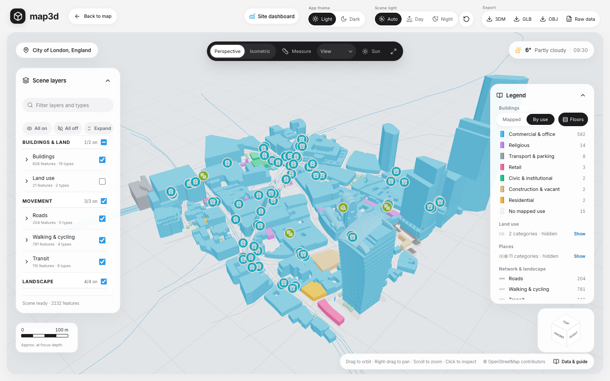
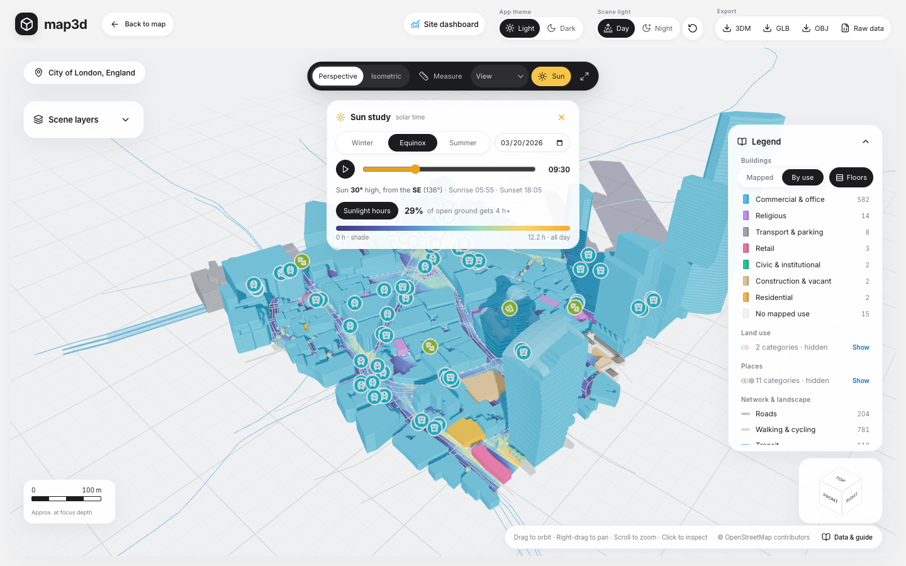
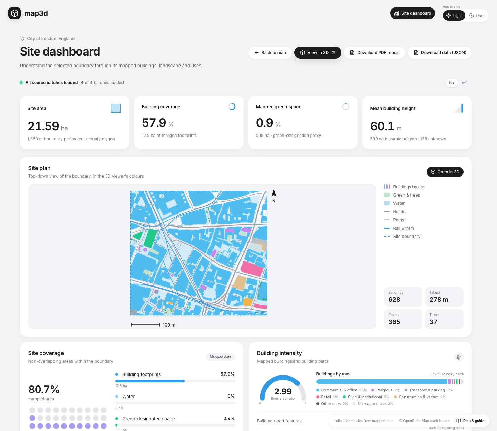
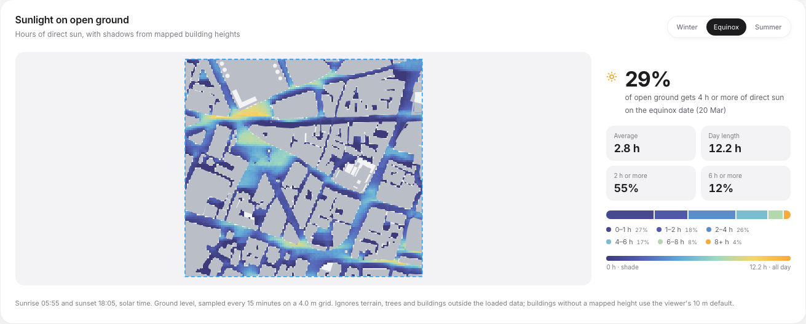
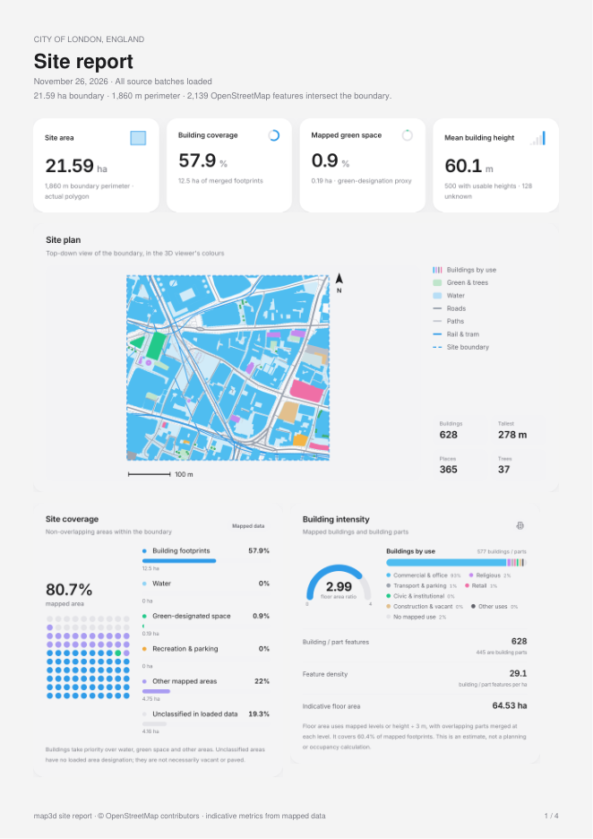

# map3d

**Turn any place on Earth into an explorable 3D site model and an instant site analysis.**

Draw a boundary on the map, and map3d builds a 3D scene from OpenStreetMap: buildings coloured by use, roads, transit, water, green space, trees and places. It adds a sun and shadow study, live weather, and a site dashboard you can download as a PDF report.



> [!IMPORTANT]
> map3d uses community-mapped OpenStreetMap data. Heights, uses and other tags can be missing or wrong. All figures are indicative and are not a survey, zoning assessment or planning calculation. Verify independently and use at your own risk.

---

## Contents

- [Features](#features)
- [Quick start](#quick-start)
- [Using the app](#using-the-app)
- [Data sources and attribution](#data-sources-and-attribution)
- [How the numbers are calculated](#how-the-numbers-are-calculated)
- [Project structure](#project-structure)
- [Testing](#testing)
- [Deployment](#deployment)
- [Credits and licence](#credits-and-licence)

---

## Features

### 3D viewer
- **Real-world scene from OpenStreetMap:** buildings (with mapped roofs and building parts), roads, walking and cycling paths, transit, trees, water, waterways, green spaces, land use, recreation and places of interest.
- **Buildings coloured by use**, such as commercial, residential, civic and religious, with storey lines on facades. Both are on by default and can be switched to mapped colours.
- **Optional terrain** from open elevation tiles.
- **Camera tools:**
  - Perspective or isometric view, plus a view cube with preset directions.
  - A focus mode that hides the interface.
  - A live scale bar.
  - A **Measure** tool for 3D, horizontal and height distances.
- **Inspector:** click any building or feature to see its OpenStreetMap tags.
- **Light and dark themes**, and a **Scene light** setting of Auto, Day or Night.

### Layers and legend
- **Layer drawer:**
  - Filter box that finds layers, categories and individual types.
  - **All on / All off** and **Expand all**.
  - A switch for each section.
  - Hover **Only** buttons to isolate a layer, category or type.
  - Unticking a layer hides its items, but they stay selectable, so you can tick a few to show just those.
- **Floating legend:** explains every colour on screen. Each entry is also a show/hide switch, and the panel holds the Mapped / By use and Floors controls.

### Sun and shadow study



- **Sun position:** worked out from the site's latitude, a date (Winter, Equinox and Summer presets, or any date) and a solar time.
- **Shadows:** buildings and trees cast real-time shadows. You can animate a whole day from sunrise to sunset.
- **Sunlight hours:** colours open ground by hours of direct sun, with the share of ground that gets at least 4 hours.

### Live weather
- **Current conditions at the site** from [Open-Meteo](https://open-meteo.com): temperature, feels-like, wind, cloud cover, humidity and precipitation, plus the site's local time.
- **Auto scene light** switches the viewer to night when it is night at the site.
- **Weather in the scene:**
  - Clouds dim the light and turn the sky grey, and fog closes in.
  - Rain and drizzle fall, angled by the real wind direction, and snow drifts.
  - Thunderstorms flash.
- **Switches:** live weather and the 3D effects can each be turned off, and both choices are remembered.

### Site dashboard and reports



**Headline numbers:** site area, building coverage, green space and mean building height, each with a small chart.

**Cards:**

| Card | Shows |
| --- | --- |
| **Site plan** | A top-down plan of the boundary in the viewer's colours, with a scale bar, north arrow and key counts. |
| **Site coverage** | A dot chart and bars of buildings, water, green space, recreation and other land. |
| **Building intensity** | A floor area ratio gauge, buildings by use, density and indicative floor area. |
| **Building heights** | A height histogram and the tallest buildings drawn side by side to scale. |
| **Land-use allocation**, **Landscape and movement**, **Places and amenities** | Bars, line swatches, tree icons and place badges. |
| **Sunlight on open ground** | A map of hours of direct sun, with Winter, Equinox and Summer presets. |
| **Data coverage and methodology** | Which source batches loaded, with the calculation method on demand. |



**Downloads:**
- **Download PDF report:** an A4 report with every card plus a methodology page.
- **Download data (JSON):** all metrics, the boundary, source statuses and methods.



### Exports

| Button | File | Contents |
| --- | --- | --- |
| **GLB** | `scene.glb` | Visible layers with materials |
| **OBJ** | `scene.obj` | Visible geometry, metres, Y up, no materials |
| **3DM** | Rhino 7+ file | All loaded geometry, including hidden layers, as a `Map3d → layer → type` hierarchy. Includes OSM IDs and tags, colours, and metric coordinates (Z up). |
| **Raw data** | `map-data.json` | Unmodified OSM elements, the boundary, batch statuses, layer visibility and sampled elevation |

---

## Quick start

Requires **Node.js 22.18 or newer**; Node 24 is recommended.

```bash
npm ci --ignore-scripts
npm run dev
```

Open http://127.0.0.1:5173. No API keys are needed: map data, search, elevation and weather all use free public services.

```bash
npm run build     # type-check and production bundle in dist/
npm run preview   # serve the production build locally
```

---

## Using the app

1. **Find a place:** search for a city, address or postcode.
2. **Draw a boundary:**
   - **Rectangle:** click two opposite corners.
   - **Polygon:** click the corners, then click the first point or press Enter to finish.
   - Escape cancels the drawing.
3. **Generate 3D scene:** the viewer opens straight away. Data loads in four batches (buildings, transport, landscape, places and recreation) and appears as it arrives.
4. **Explore the scene:**
   - Drag to orbit, right-drag to pan, scroll to zoom.
   - Click a feature to inspect it.
   - Use the layer drawer and legend to choose what is shown.
5. **Sun:** the **Sun** button in the viewer toolbar opens the sun study.
6. **Weather:** the weather chip at the top right shows current conditions and its switches.
7. **Site dashboard:** opens the analysis for the same boundary, from where you can download the PDF report or JSON data.

The app has three routes, `/map`, `/viewer` and `/dashboard`. Browser Back and Forward restore each boundary. Refreshing a page restores the last boundary for that tab. Production hosting must serve `index.html` for all three routes; Vite dev and preview already do.

---

## Data sources and attribution

| Data | Source | Notes |
| --- | --- | --- |
| Map features | [OpenStreetMap](https://www.openstreetmap.org/copyright) via Overpass API | © OpenStreetMap contributors, ODbL |
| Search | [Nominatim](https://nominatim.org) | Requested only when you submit a search |
| Base map tiles | OpenStreetMap tiles | |
| Elevation | [Mapzen Terrarium tiles](https://github.com/tilezen/joerd/blob/master/docs/formats.md) on AWS | [Attribution](https://github.com/tilezen/joerd/blob/master/docs/attribution.md) |
| Weather | [Open-Meteo](https://open-meteo.com) | Free for **non-commercial** use, no key, CC BY 4.0. Only coordinates rounded to about 1 km are sent. |

> [!NOTE]
> Open-Meteo's free tier is for non-commercial use only. A commercial deployment needs an Open-Meteo subscription, or the weather feature switched off.

---

## How the numbers are calculated

- **Building heights:** a mapped `height` (metres or feet) is used first. Failing that, 3 m per mapped level.
  - The viewer draws buildings with no height at 10 m. The dashboard leaves them out of its height and floor statistics.
  - Mapped minimum heights and roof shapes (flat, gabled, pyramidal) are respected.
- **Areas:** calculated on a local flat projection and clipped to the exact boundary, including concave shapes, with courtyards removed and overlaps merged. Accuracy drops for very large regions and near the poles.
- **Coverage:** each piece of ground counts once, in priority order: buildings, water, green space, recreation and parking, other mapped land.
  - Green space is a proxy for areas tagged as green, not measured vegetation.
  - Unclassified does not mean vacant.
- **Floor area and floor area ratio:** built from mapped levels, or height ÷ 3 m, with overlapping building parts merged at each level. This is an estimate, not a planning calculation.
- **Buildings by use:** a building's own type comes first. Otherwise it takes the smallest land-use area containing its centre.
- **Sun position:** calculated from the latitude, the date's solar declination and the **solar time**, where 12:00 is solar noon.
  - Solar time can differ from clock time by up to about an hour, or more under daylight saving.
  - Sunlight hours trace rays every 15 minutes from a grid of 2–4 m ground cells.
  - They assume flat ground, and ignore trees and buildings outside the loaded data.
- **Weather:** Open-Meteo's current conditions, using standard WMO weather codes. Its day/night flag drives Auto scene light.

---

## Project structure

```
src/
  ui/          App shell, layer drawer, legend, dashboard, weather chip, PDF report, theme CSS
  three/       3D scene: geometry, batching, shadows and sun study, weather effects, exports
  data/        Map loading, layers, site analysis, solar maths, sunlight, weather, styles
  hooks/       Data loading, analysis, sunlight and weather hooks (heavy work runs in Web Workers)
  components/  2D map and boundary drawing (Leaflet)
server/        Map-data gateway (Vite middleware locally, Cloudflare Pages Worker in production)
tests/         Unit tests (*.test.mjs) and Playwright browser tests (tests/browser)
```

Main libraries:
- React 19 with Vite and TypeScript.
- react-three-fiber and three.js for the 3D scene.
- Leaflet for the 2D map.
- clipper-lib for the site analysis.
- rhino3dm for 3DM export.
- jsPDF and html-to-image for the PDF report. They load only when a report is requested.

---

## Testing

```bash
npm run lint
npm test                                     # unit tests (Node 22.18+)
npx playwright install chromium
npm run test:e2e                             # browser tests
```

What the unit tests cover:
- Layer normalisation, building heights and terrain.
- Map loading, including retries, cooldowns and caching.
- Site analysis.
- Layer filtering.
- Solar position and sunlight hours.
- Weather parsing.
- Rhino export: files are reopened with McNeel's reader to check layers, groups, materials and coordinates.

What the browser tests cover:
- Drawing a boundary and incremental loading with partial failures.
- Layers, legend and inspection.
- Exports.
- The dashboard and the PDF and JSON downloads.
- The sun study and live weather.
- Phone layouts.

The browser tests use synthetic map data and turn live weather off by default, so they never call live services.

To test the production bundle:

```bash
VITE_MAP_DATA_TRANSPORT=direct npm run build
PLAYWRIGHT_PREVIEW=1 npm run test:e2e -- tests/browser/map.spec.ts tests/browser/rhino.spec.ts
```

---

## Deployment

### Cloudflare Pages

`npm run build` also outputs a Pages Advanced Mode `_worker.js` and `_routes.json`. Upload the **contents** of `dist/` to Cloudflare Pages.

- **The map-data gateway:** only `/api/interpreter` runs the Worker. It is the same-origin endpoint the app uses for map data.
- **What the gateway accepts:** only this app's generated queries.
- **Caching:** complete responses are cached at the edge for 15 minutes, and identical requests share one response.
- **Pacing and fallback:** upstream requests are paced, and it falls back to a backup Overpass server after a failure.
- **Faster cancellation:** enable the `enable_request_signal` compatibility flag so cancelled browser requests also cancel the upstream request.

The `elenichas/map3d` fork deploys `main` to the `map3d-studio-eleni` Pages project from the **Checks** workflow, after lint, unit tests, build and browser tests pass. This needs two settings in GitHub:
- The repository secret `CLOUDFLARE_API_TOKEN`, with Pages Edit permission.
- The repository variable `CLOUDFLARE_ACCOUNT_ID`.

### How map data loads

- **Order:** the four batches load one at a time, with a gap between requests. Batches for visible layers go first.
- **Retries:** rate limits back off and respect `Retry-After`. A failed batch lets other batches through, then retries automatically. If it keeps failing it is split into smaller requests, within a bounded budget.
- **Partial failure:** loaded layers stay usable if another batch fails.
- **Stop and retry:** the drawer has **Stop loading layers** and **Retry unavailable layers**.
- **Large areas:** very large or dense boundaries can still exceed the public servers' limits.

### Optional overpass.ch provider

To use [overpass.ch](https://overpass.ch/docs) instead of the public Overpass servers:

1. Create an **All APIs** key at overpass.ch.
2. In the Pages project's **Settings → Variables and Secrets**, set:
   - `MAP_DATA_PROVIDER=overpass-ch` as a text variable.
   - `OVERPASS_CH_API_KEY` as an encrypted secret.
3. Redeploy.

Notes:
- **Never use a `VITE_` prefix for the key;** anything with that prefix is shipped to browsers.
- **Local testing:** copy `.env.example` to `.env.local`.
- **Default:** with no settings, the public providers are used.
- **Errors:** authentication and quota errors stop automatic retries and show a clear message.

### Static hosting without the gateway

Build with `VITE_MAP_DATA_TRANSPORT=direct npm run build` to call public Overpass servers directly from the browser. This is less reliable, because it depends on those servers allowing browser requests.

---

## Credits and licence

map3d Studio is a fork of [cartesiancs/map3d](https://github.com/cartesiancs/map3d) by Hyeong Jun Huh ([GitHub](https://github.com/DipokalLab)). It is extended with the layer system, site analysis dashboard, PDF reports, sun study, live weather, Rhino export and the studio interface.

MIT License. Map data © OpenStreetMap contributors (ODbL). Weather data by Open-Meteo.com (CC BY 4.0).
